# RemoteApp y RD Web Client con IIS y Autenticación Centralizada AAA (NPS/RADIUS)


Laboratorio que publica aplicaciones remotas con **RDS RemoteApp** (entregadas tanto por el portal clásico **RD Web Access** como por el cliente HTML5 **RD Web Client**), sirve una página personalizada de **IIS** y la publica como RemoteApp, y controla el **acceso administrativo** a un router Cisco mediante **AAA** validado por un servidor **NPS/RADIUS** de Windows, con dos niveles de privilegio según el grupo de dominio del usuario.

**Autor:** Julio Cesar Hernandez Tibrey
**Matrícula:** 2025-0702

- **Video:** https://www.youtube.com/watch?v=IUC7Qoyg5u8&t=13s
---

## Resumen

La idea central de una **RemoteApp** es que la aplicación se ejecuta íntegramente en el servidor y al cliente solo le llega su ventana. El usuario ve lo que parece un programa local, pero cada clic, cada cálculo y cada conexión de red ocurren en el servidor. Este laboratorio entrega esa RemoteApp por dos vías: el portal clásico **RD Web Access** (que descarga un archivo `.rdp` abierto por el cliente de Escritorio Remoto) y el **RD Web Client** (un cliente HTML5 que ejecuta la app dentro del navegador).

El acceso administrativo al router se centraliza con **AAA** (Authentication, Authorization, Accounting) delegado en un servidor **RADIUS**. El rol **NPS** de Windows valida las credenciales contra Active Directory y, según el grupo del usuario, devuelve al router el nivel de privilegio que debe otorgar mediante el atributo de proveedor de Cisco, el par `shell:priv-lvl`. El router no conoce los grupos del dominio: solo obedece ese atributo.

**Objetivos:** desplegar RDS/RemoteApp y el RD Web Client, servir una página personalizada de IIS y publicarla como RemoteApp, levantar NPS/RADIUS con dos niveles de acceso (privilegio 15 y privilegio 1) atados a grupos del dominio, y configurar el router con usuario local, SSH y AAA sobre RADIUS con registro.

---

## Entorno del laboratorio

Un router central (R-3) conecta tres dominios de red: internet a través del ISP (nube NAT de PNETLab), el segmento de servidores y el de clientes. Un único Windows Server 2019 concentra todos los roles del lado servidor, y una VM Windows 10 actúa como cliente.

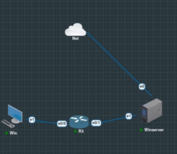

El direccionamiento deriva de la matrícula **2025-0702** (ambos segmentos usan el patrón `.7.2`, clave RADIUS `Radius0702`).

| Dispositivo | Interfaz | IP / Máscara       | Función                              |
| :---------- | :------- | :----------------- | :----------------------------------- |
| R-CORE      | gig0/1   | 10.7.2.1/24        | Gateway de servidores, origen RADIUS |
| R-CORE      | gig0/0   | 10.7.1.1/24        | Gateway de clientes, relay DHCP      |
| DC          | Ethernet | 10.7.2.2/24        | AD DS, DNS, DHCP, NPS, RDS, IIS      |
| Windows 11  | Ethernet | 10.7.2.2/24 (DHCP) | Cliente de pruebas                   |


---

## Baseline (preexistente)

Active Directory (dominio `SEGREDES.local`), DNS y DHCP ya estaban configurados antes de esta práctica. Lo relevante para RADIUS son los dos grupos de TI: **NET-ADMINS** (privilegio 15) y **NET-SUPPORT** (privilegio 1), 


| Usuario     | Login | OU  | Grupo      | Acceso al router            |
| :---------- | :---- | :-- | :--------- | :-------------------------- |
| admin-users | admin | TI  | NET-ADMINS | Privilegio 15 (total)       |
| read-users  | read  | TI  | NET-USERS  | Privilegio 1 (solo lectura) |

---

## Despliegue RDS / RemoteApp

RDS se desplegó con la instalación dedicada de **Remote Desktop Services** en modo **Quick Start**, escenario **Session-based** (no como roles sueltos). Esto instala y enlaza tres roles en el mismo servidor: **RD Web Access** (el portal `/RDWeb`), **RD Connection Broker** (reparte y administra las sesiones) y **RD Session Host** (donde realmente corren las apps).

El flujo importa: el usuario nunca se conecta directo al Session Host. Entra por el portal, el broker lo autentica y lo dirige, la app se ejecuta en el Session Host, y al cliente solo le llega la ventana de la aplicación.

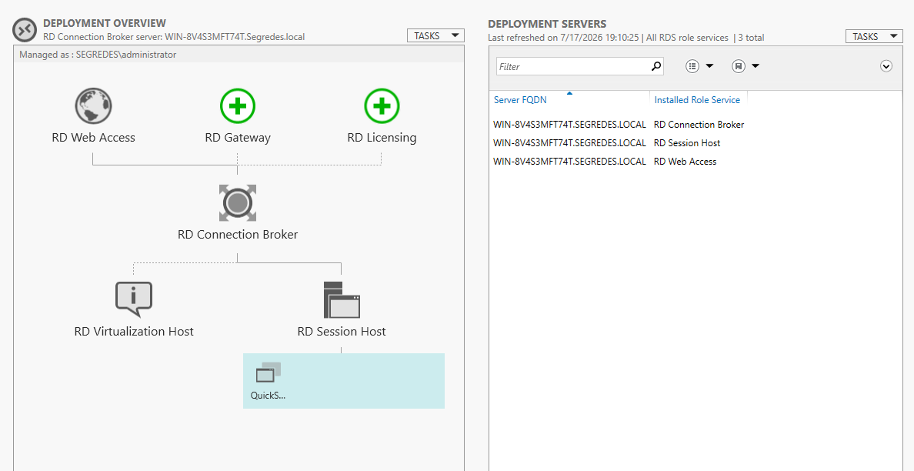

Las RemoteApp se publicaron en la colección `QuickSessionCollection`, asignada al grupo de usuarios del dominio.

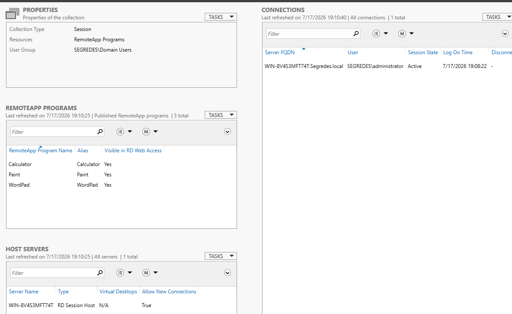


---

## Certificado del servicio

El certificado que RDS genera solo **no** servía en los navegadores modernos. El problema no era de confianza, sino del **Key Usage** del certificado: le faltaba el atributo **DigitalSignature**. Los cifrados TLS modernos basados en `ECDHE_RSA` (los que negocian Chrome y Edge por defecto) requieren que el certificado del servidor lleve el bit `digitalSignature`, y el certificado autogenerado solo traía `keyEncipherment`. Por eso Chrome y Edge 115+ rechazan el handshake con **`ERR_SSL_KEY_USAGE_INCOMPATIBLE`**.

Un detalle revelador: la RemoteApp abierta por el cliente de Escritorio Remoto (`mstsc`, el archivo `.rdp`) sí funcionaba con ese certificado, porque el cliente RDP no valida ese atributo. Solo el navegador lo hace. Así que el certificado defectuoso rompía las vías por navegador (la página de IIS y el RD Web Client), pero no la vía `.rdp`.

La solución fue generar por PowerShell un certificado nuevo con los Key Usages correctos (**DigitalSignature** y **KeyEncipherment**), asignarlo a los tres roles del despliegue RDS y al binding 443 de IIS, e importarlo como certificado de confianza en el cliente para que el candado saliera limpio.


------

## Página personalizada de IIS y su publicación como RemoteApp

IIS ya estaba presente porque RD Web Access corre sobre él. Se colocó una página de portada con el nombre y la matrícula en `wwwroot`, servida en la raíz `https://10.7.2.2` con el mismo certificado.

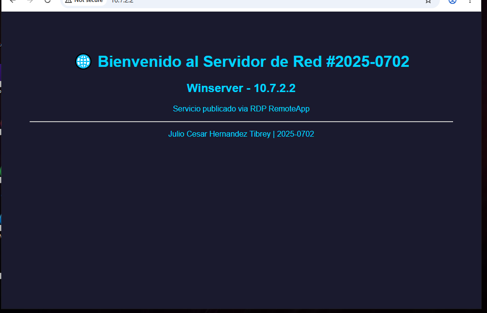

El binding 443 se configuró con el certificado `SEGREDES.LOCAL`.

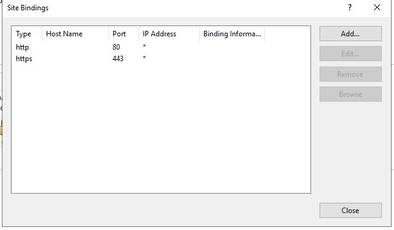

---

## NPS como servidor RADIUS

El rol **NPS** convierte al servidor en un RADIUS. Se registró en Active Directory para poder leer usuarios y grupos del dominio. Escucha en `10.7.2.2`.

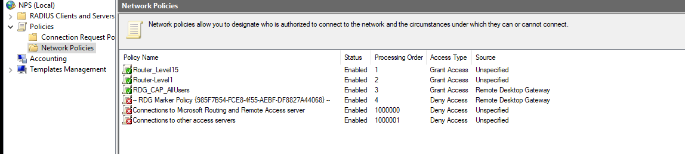
Tres detalles son determinantes en ambas políticas:

1. El control clave es el atributo **Cisco-AV-Pair** `shell:priv-lvl` (15 o 1). Le indica al router qué privilegio dar según el grupo de AD. El router no sabe de grupos; solo obedece el atributo.
2. Ambas habilitan autenticación **PAP**, porque el IOS envía las credenciales al RADIUS usando PAP. Si el NPS no acepta PAP, rechaza todo por incompatibilidad de método.
3. El `Service-Type` se fija en `Login` y se retira el atributo `Framed-Protocol`, dejando solo lo pertinente a una sesión de administración.

El orden importa: el NPS evalúa de arriba hacia abajo y aplica la primera política que coincide, por eso la de privilegio 15 va encima. Un usuario de NET-ADMINS coincide con la primera (privilegio 15); uno de NET-SUPPORT solo con la segunda (privilegio 1); uno que no esté en ningún grupo no coincide con ninguna política de concesión y es rechazado.

---

## Router R-CORE: AAA, RADIUS y hardening

Toda la configuración de seguridad se agregó de forma **aditiva** sobre la base que el router ya tenía (interfaces y NAT), sin tocarla.

### Usuario local y enable secret

Un usuario local `Admin-local` (privilegio 15) y un `enable secret` protegen el modo privilegiado/configuración. El usuario local cumple el requisito y sirve de respaldo anti-bloqueo si el RADIUS falla (las listas de métodos caen a `local`). Ambos secretos se guardan como hash.

### AAA y RADIUS

Se activa AAA (`aaa new-model`), el servidor RADIUS apunta a `10.7.2.2` (puertos 1812/1813, mismo secreto), y se agrupa en `GRP-RADIUS` con `ip radius source-interface Ethernet0/0` para que los paquetes RADIUS salgan con origen `10.7.2.2`, la IP registrada como cliente en NPS. Se habilitan los atributos de proveedor con `radius-server vsa send authentication` y `accounting`.


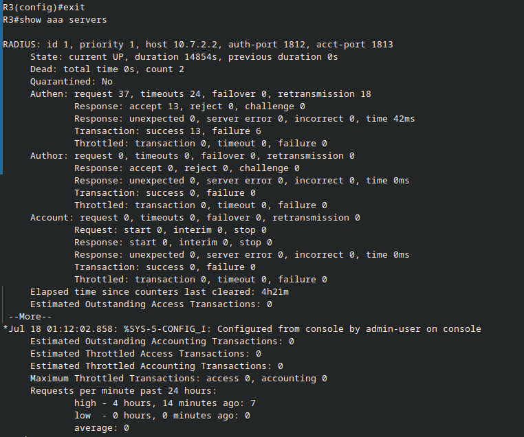

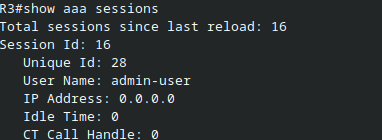
Dos piezas hacen efectiva la diferenciación de privilegios:

- **Envío de VSA:** sin `radius-server vsa send authentication`, el atributo `shell:priv-lvl` llega pero el router lo ignora, y el usuario cae siempre en privilegio 1.
- **Autorización de exec** (`aaa authorization exec default group GRP-RADIUS local if-authenticated`): la autenticación solo verifica identidad; es la autorización de exec la que lee el privilegio devuelto y abre la sesión en ese nivel. Sin esa línea, el usuario autentica pero cae siempre en privilegio 1.


---

## Verificación

### 1. Página por RD Web Access (portal clásico)

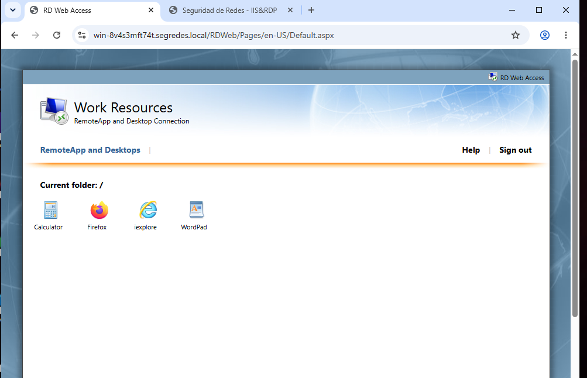


### 2. Página por RD Web Client (HTML5)

La segunda vía ejecuta las apps dentro del navegador, sin descarga.

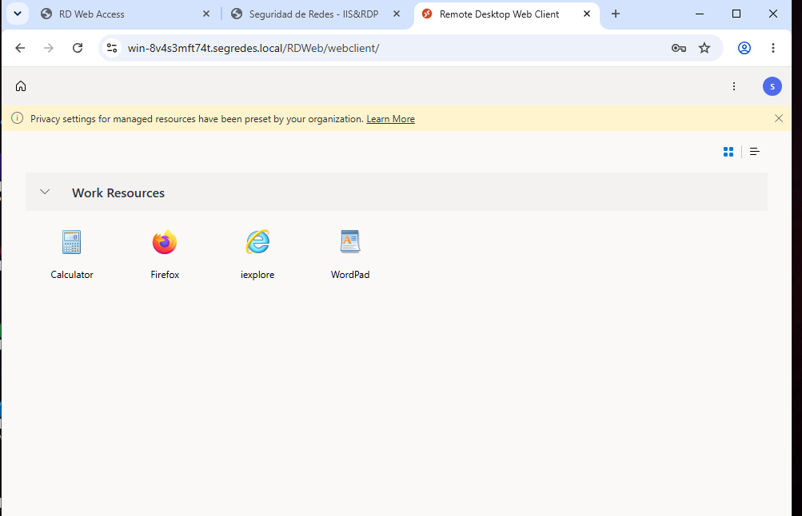

Es la misma RemoteApp entregada de dos formas distintas.

### 3. Diagnóstico de AAA en el router

`test aaa` valida la cadena RADIUS sin abrir una sesión SSH, confirmando la autenticación y el privilegio devuelto.

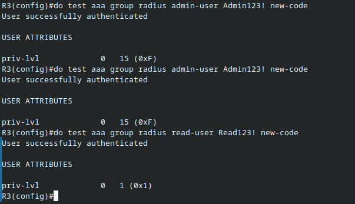


Se activa la depuración de autenticación, autorización y RADIUS para trazar el flujo completo.

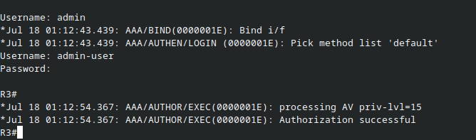

---

## Referencia CLI del router

Los secretos aparecen como marcadores; en el dispositivo se guardan cifrados.

**Base preexistente (interfaces):**

```
hostname R-3
no ip domain-lookup

interface GigabitEthernet0/0
 ip address 10.7.2.1 255.255.255.0
 ip nat inside
 no shutdown

interface GigabitEthernet0/5
 ip address 10.7.1.1 255.255.255.0
 ip nat inside
 no shutdown

```

**Usuario local, enable secret y SSH:**

```
username Julio privilege 15 secret <PASSWORD>
enable secret <ENABLE_SECRET>

ip domain name Julio.local
crypto key generate rsa modulus 2048
ip ssh version 2
ip ssh time-out 60
ip ssh authentication-retries 3
```

**AAA y RADIUS:**

```
aaa new-model

radius server NPS
 address ipv4 10.7.2.2 auth-port 1812 acct-port 1813
 key <RADIUS_KEY>

aaa group server radius GRP-RADIUS
 server name NPS
 ip radius source-interface GigabitEthernet0/4

radius-server vsa send authentication
radius-server vsa send accounting

aaa authentication login CONSOLE local
aaa authentication login default group GRP-RADIUS local
aaa authorization exec default group GRP-RADIUS local if-authenticated
aaa accounting exec default start-stop group GRP-RADIUS
aaa session-id common
```

**Líneas y registro:**

```
line console 0
 login authentication CONSOLE
line vty 0 4
 transport input ssh
 login authentication default
 authorization exec default
 exec-timeout 10 0

service timestamps debug datetime msec
service timestamps log datetime msec
logging buffered 16384 debugging
login on-failure log
login on-success log
```

**Comandos de verificación:**

```
test aaa group GRP-RADIUS <usuario> <password> new-code
debug aaa authentication
debug aaa authorization
debug radius
show aaa servers
show aaa sessions
show logging
show ip ssh
```

---

## Conclusión

El laboratorio publica RemoteApps por dos vías (RD Web Access con `.rdp` y el RD Web Client en HTML5), resuelve el certificado TLS regenerándolo con los Key Usages correctos para que los navegadores modernos lo acepten, sirve una página personalizada de IIS por HTTPS y la expone como RemoteApp mediante Edge en modo aplicación, y centraliza el acceso al router con NPS/RADIUS. El router delega la autenticación y la autorización en RADIUS y aplica el privilegio devuelto en el atributo `shell:priv-lvl`, siendo el envío de VSA y la autorización de exec las dos piezas que hacen efectiva la diferenciación.

Las pruebas confirman cada objetivo de extremo a extremo: la página es accesible por las dos vías de RemoteApp, la RemoteApp de Edge entrega internet que el cliente por sí solo no tiene (demostrando que la app corre en el servidor), y el acceso SSH se comporta según la identidad: admin-user con privilegio 15, read-user con privilegio 1 de solo lecturaLa. evidencia del router (`test aaa`, trazas de debug, `show aaa servers`/`sessions`)
